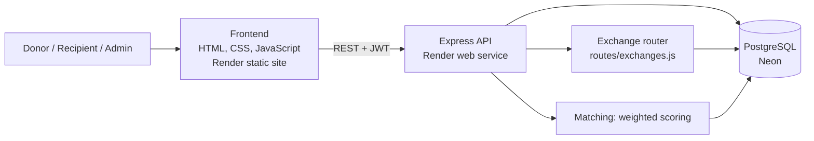

# ReSourceX: Final Review Pack

Everything in this document is backed by code in the repository or by a test that was actually run.
Items that were **not** tested are labelled *manual* or *not implemented*.

## 1. Problem and solution

Useful surplus resources (books, equipment, furniture) go to waste while colleges, NGOs and community
groups nearby need them. ReSourceX connects the two sides, supports donations and resource-for-resource
exchanges, and tracks every transfer from listing to confirmed receipt.

**What makes it more than a donor/recipient form**

| Differentiator | Where to see it |
|---|---|
| Explainable matching: a 0-100 score (category 30, location 20, quantity 20, urgency 15, availability 15) with a plain-language reason for each factor | Recipient dashboard; test T06 asserts the exact scores |
| Controlled lifecycle: `AVAILABLE → REQUESTED → ALLOCATED → HANDED_OVER → COMPLETED`, each step restricted to the right role | Tests T07-T09 |
| Exchange with accept / decline / counteroffer and two-sided handover and receipt; partial quantities leave the remaining stock available | Exchanges page; tests T13-T15 |
| Privacy by stage: contact details and exact pickup location are hidden until a request is approved or an exchange accepted, and only if the owner allows it | Test T11 |
| Accountability: persistent notifications, transaction messaging, a per-resource history ("passport"), organisation verification, an impact summary | Bell icon, 💬 Message button, `/api/resources/:id/history`, `/api/impact` |

## 2. Architecture

Security controls: bcrypt password hashing (12 rounds), signed JWTs checked against the database on every
request (deleted accounts are rejected), role checks per route, ownership checks, parameterised SQL,
row locks (`SELECT ... FOR UPDATE`) on every state change, restricted CORS origins.

## 3. Database

| Table | Purpose |
|---|---|
| `users` | Accounts, role, organisation details, location-privacy setting, verification flag |
| `resources` | Listings with quantity, condition, status |
| `requests` | Donation requests and their status/timestamps |
| `exchanges`, `exchange_resources` | Two-sided exchange proposals; one row per side with quantity and fulfilled quantity |
| `messages` | Conversations linked to a request or an exchange (database check: exactly one) |
| `notifications` | Per-user in-app notification centre |
| `resource_history` | Audit trail per resource |
| `organisation_verifications` | Record of each administrator verification decision |

### Applying the schema safely

| Your database | What to run |
|---|---|
| New, empty | `backend/schema.sql` |
| Existing (users / resources / requests only) | Back up, then `backend/migrations/phase5_enhancements.sql` |
| Existing with the old exchange table | Same single migration; it converts the old layout and keeps existing exchanges |

Verified on 25 Oct 2026 with PostgreSQL 16: the migration runs twice without errors, converts a legacy
`OFFERED` exchange to `PROPOSED` and backfills its resource links, and a migrated 3-table database ends up
with exactly the same columns as a fresh `schema.sql`. Do not run `001_create_exchanges.sql`; it is a no-op.
Try the migration on a Neon branch first, then production.

## 4. Requirements

### Functional (status = verified by automated test unless noted)

| ID | Requirement | Status |
|---|---|---|
| FR1 | Users register and sign in with a role (donor, recipient; admin needs a code) | Verified (T01-T03) |
| FR2 | Donors manage their resource listings; others cannot edit or delete them | Verified (T04) |
| FR3 | Recipients discover resources and see ranked matches with reasons | Verified (T05, T06) |
| FR4 | Recipients request a resource; one request wins when several arrive at once | Verified (concurrency test) |
| FR5 | Donors approve or decline; handover then receipt confirmation | Verified (T07-T09) |
| FR6 | Resource-for-resource exchange with counteroffer and two-party confirmation | Verified (T13-T15) |
| FR7 | Contact and location details are shared only when appropriate | Verified (T11) |
| FR8 | In-app notifications for requests, exchanges, messages, verification | Verified |
| FR9 | Messaging between the two parties of a request or exchange | Verified |
| FR10 | Administrators view statistics and users, verify organisations, remove users | Verified (T12) |
| FR11 | Resource history and impact summary | Verified |

### Non-functional

| Quality | What exists | How it was checked |
|---|---|---|
| Security | bcrypt, JWT, role and ownership checks, token revalidation | Automated permission tests (T10 and others) |
| Privacy | Staged disclosure of email and location | T11 |
| Reliability | Transactional state changes, row locking, no double allocation | Concurrency test, lifecycle tests |
| Maintainability | Frontend / API / database separated; exchange logic in its own module | Code review |
| Usability | Clear error messages, notifications, in-page messaging | *Manual* |
| Availability | `/api/health` reports database connectivity | T17 (local); deployed check is *manual* |

No numeric performance or uptime targets were defined, so none are claimed.

## 5. Test evidence

Run on 25 Oct 2026 (`npm test`, 21 tests, PostgreSQL 16): **21 pass, 0 fail** on each of three database shapes
(fresh schema; migrated from the old 3-table schema; migrated from the old exchange schema).

| ID | Check | Result |
|---|---|---|
| T01 | Register (validation, duplicate email, admin code) | Pass |
| T02 / T03 | Sign in with valid / invalid credentials | Pass |
| T04 | Create resource, validation, ownership | Pass |
| T05 | Recipient browses available resources | Pass |
| T06 | Match scores and reasons are consistent with the documented weights | Pass |
| T07 | Submit a request | Pass |
| T08 | Only the authorised donor approves or declines | Pass |
| T09 | Handover and receipt, statuses and timestamps | Pass |
| T10 | Unauthorised actions rejected | Pass |
| T11 | Privacy of email and location | Pass |
| T12 | Admin statistics equal database counts | Pass |
| T13-T15 | Create, counter, accept, complete an exchange; invalid completion rejected | Pass |
| T16 | Data persists after signing in again | Pass |
| T17 | Health check and JSON 404 (local) | Pass |
| T17 | Deployed frontend loads and reaches the API | *Manual* |
| T18 | Mobile layout | *Manual* |

The notification bell and messaging window were also exercised in a simulated browser (jsdom) against the
running API: badge count, mark-as-read, opening a conversation from a notification, sending a message,
and HTML in a message being escaped. A visual check in a real browser is still *manual*.

### Defects found and fixed during this testing

| # | Defect | Fix |
|---|---|---|
| 1 | The Phase 5 migration left the legacy `'OFFERED'` default on `exchanges.status`, which the new constraint rejects, so every new exchange insert would fail on an upgraded database | Default set to `'PROPOSED'` in the migration |
| 2 | A deleted user's token kept working for up to 7 days | Token revalidated against the database on every request |
| 3 | An administrator could delete their own account (string vs number id comparison) | Compared as strings |
| 4 | Deleting a resource that appeared in exchange history returned HTTP 500 | Returns 409 with a clear message |
| 5 | The "Forgot password" form claimed success but only edited browser storage | Now states honestly that reset is not available yet |
| 6 | Notifications were written but could never be read | Notification API and bell added |

## 6. Ten-minute demo script

Prepare before the review (use real registration, passwords not stored in the repository):
a **donor A**, a **donor B**, a **recipient**, an **administrator**, and two or three resources.

1. **Matching** (recipient): search "Books", location and quantity; point out two results with different scores and the reasons listed.
2. **Request** (recipient): request the top match. Switch to donor A: the bell shows a notification.
3. **Privacy**: as donor A, show the request has no recipient email yet. Approve it; the email now appears.
4. **Messaging**: click 💬 Message, agree a pickup time; the recipient sees the notification.
5. **Fulfilment**: donor marks handed over; recipient confirms receipt; status becomes COMPLETED.
6. **Exchange** (donor A and B): A proposes, B counters, A accepts, both confirm handover and receipt.
7. **Admin**: statistics, verify an organisation; open `/api/impact` or the resource history for evidence.
8. **Quality**: show the green CI run on GitHub and the 21 passing tests.

Rehearse twice. Keep a backup screen recording in case the free Render instance is asleep. Open the site
a few minutes early to wake it.

## 7. Agile process evidence

Prepare these from your real project-management records (Azure Boards or equivalent). Do not present
retrospective items as if they had been tracked:

- backlog with user stories and acceptance criteria (the requirement IDs above can be the stories);
- sprint or iteration view with task status;
- commit history and pull requests (GitHub) showing incremental delivery;
- this repository's CI runs and test results as definition-of-done evidence.

## 8. Known limitations and future work

- Password reset by email is not implemented (needs an email service).
- Notifications and messages refresh by polling (30 s / 8 s), not real-time push.
- No map view, no rate limiting, no reporting/moderation workflow, no email notifications.
- Verification records an administrator's decision; it does not check documents automatically.
- Matching is rule-based. A machine-learning ranking was deliberately not added because there is no
  interaction data to train or evaluate it on; the next step would be to log recommendation outcomes.
- The deployed Render/Neon environment was not accessible while preparing this pack; verify it manually.

## 9. Phase 6: profile, map, search and the matching data foundation

Added after the initial review pack, in response to feedback that the project looked too similar to
other donation systems and that basic participant information was missing.

| Area | What was built | How it was checked |
|---|---|---|
| Search | Every word must match name, category, location, description or specifications, as a substring. "eng" finds "Engineering" textbooks; the category filter accepts partial words; SQL wildcard characters are stripped. | Tests `search: short words...`; browser check of "eng" |
| Address and phone | Profile page with name, phone, organisation, street address, city, state, country, postal code. Phone number format is validated. | Test `profile: address, phone...`; browser save test |
| Map position | Optional latitude/longitude on resources and on the profile, with a "Use my location" button. Other users see coordinates rounded to about 1 km; owners see exact values; owners who choose "none" show nothing. | Test `coordinates: ...`; map browser checks |
| Map view | Recipients see matching resources on an OpenStreetMap map (Leaflet 1.9.4). Popups escape user text. The page still works if the map fails to load. | Browser check with and without the map library |
| Distance ranking | When the recipient shares a location, the location factor uses distance (within 5 km scores full marks, then 25 km, 100 km and beyond). Documented weights are unchanged. | Test `matching uses distance...` |
| Notifications and messaging | Bell icon and request chat window (from the earlier patch). | jsdom test from the earlier patch |
| Exchange | Propose, counteroffer, accept, two-sided handover and receipt, with partial quantities (API and page). | 21 exchange-related API tests; the exchange page was not tested in a browser |
| Learning data | `match_events` records each recipient's view and request of a ranked item, with rank and score. | Test `match events...` |
| Sign-in delay | The API is pinged on load. If it takes more than 2.5 s, the sign-in page says the free server is waking up. | Browser check that the banner hides when the server answers |

### Machine learning: what we can honestly claim

The ranking is still rule-based. A learned ranking needs recorded outcomes, such as which shown
resources were chosen and which requests were approved and completed. `match_events` starts collecting
the first of these. Until there is enough real data, a learned model would be trained on invented labels,
and its results would reflect our assumptions rather than user behaviour. The recommended review answer is:
the current system is explainable and rule-based; the event log is in place so that a learned ranker can be
trained and compared against this baseline once data exists.

### Known gaps (not done in this round)

- The visual redesign was limited to clearer structure (a mode strip, a nav link and the map). A full
  redesign has not been done.
- The exchange page was checked in a simulated browser only; a real-device pass is still needed.
- Sign-in slowness on the free host cannot be fixed in code. The notice explains it; a paid instance or
  an uptime pinger keeps the server awake.
- Email notifications, password reset by email and real-time updates are not implemented.

## 10. Production readiness

### Configuration
Copy `backend/.env.example` and set the required values. In production (`NODE_ENV=production`) the server
refuses to start unless `JWT_SECRET` is at least 32 characters, a database is configured, `CORS_ORIGIN` is
set, and any `ADMIN_REGISTRATION_CODE` is at least 12 characters. The frontend API address lives in
`frontend/config.js`; change it there when you deploy to a different backend.

### Hardening in place
| Control | Implementation | Verified by |
|---|---|---|
| Startup checks | Production refuses weak or missing settings | Test: production refuses a weak JWT secret |
| Brute-force protection | Login and registration: 20 attempts per 15 minutes per client; API: 300 requests per minute | Manual run: 429 after the 20th attempt; test `rate limiter` |
| Security headers | helmet (no framework fingerprint, nosniff and others). CSP is off for now because the frontend loads Leaflet and map tiles from CDNs | Test: security headers present |
| Password storage | bcrypt, 12 rounds | Code review |
| Token trust | Tokens are checked against the database on each request | Test: deleted-account token rejected |
| Database resilience | Pool error handler (an idle dropped connection no longer crashes the process); statement timeout of 15 s | Code review |
| Graceful shutdown | SIGTERM closes the HTTP server and the pool | Test: clean exit after SIGTERM |
| Health check | `/api/health` checks the database and reports uptime | Test |
| Concurrency | Row locks on request and exchange state changes; one request wins when several arrive together | Test: concurrency |

### Known production gaps
- **Content Security Policy** is not enabled. It needs the frontend's CDN sources listed explicitly.
- **Email**: no password reset by email and no email notifications. Both need an email provider.
- **Real-time updates** use polling (about every 8 to 30 seconds), not WebSockets.
- **Backups and monitoring** depend on the hosting provider. Enable Neon point-in-time restore and an uptime check.
- **Free hosting** sleeps when idle, so the first request after a pause can take up to a minute.
- **Learned matching**: not implemented; see section 9.
- **Azure DevOps evidence** must come from your own board records.

